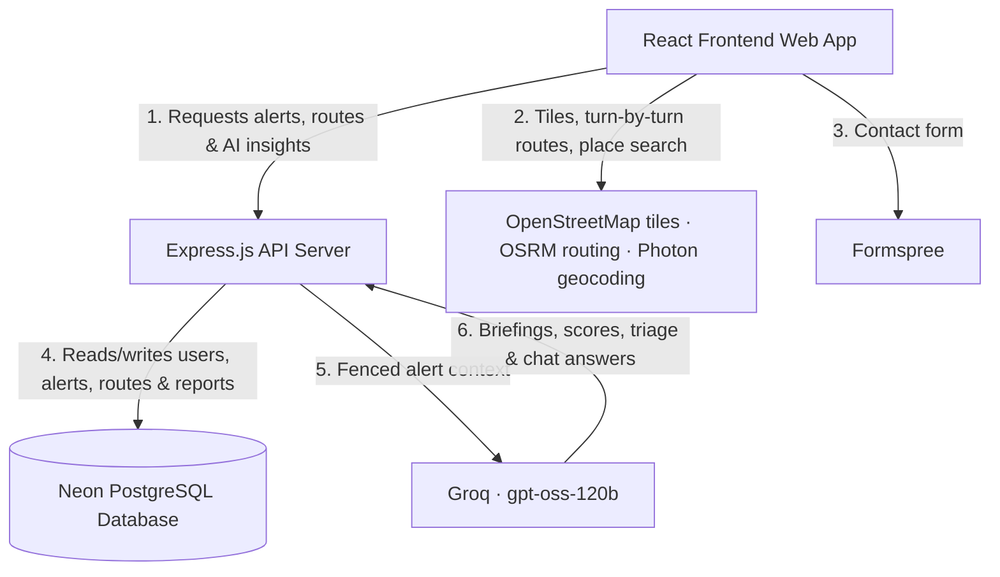
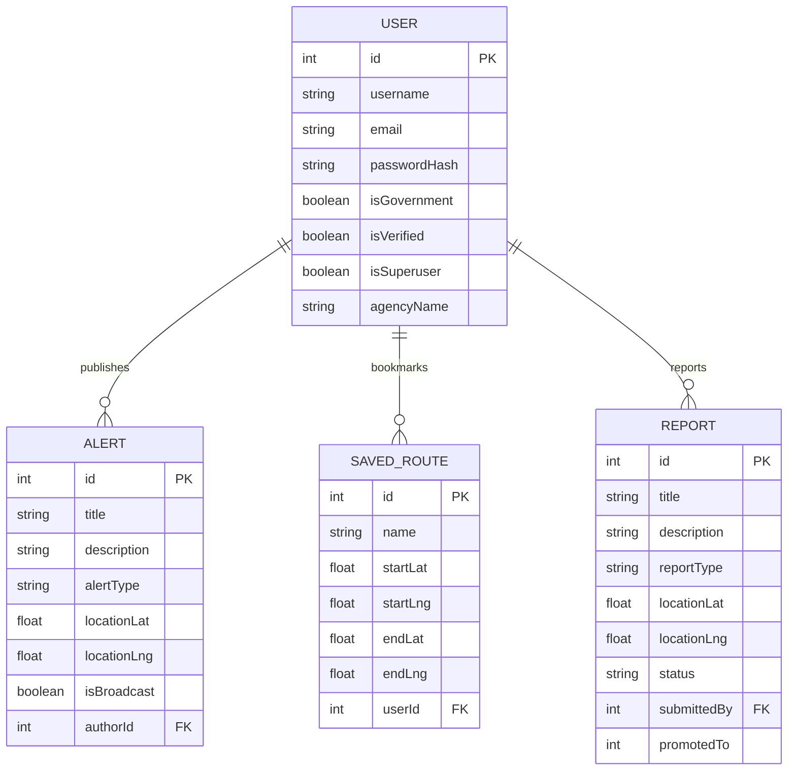

# SRANS – Smart Regional Alert & Navigation System

**🌐 [View Live Application](https://srans-smart-regional-alert-and-navi.vercel.app)** | **📄 [Read the Case Study](docs/case-study.md)** | **⚡ [Live API Portal](https://SairajJadhav08.github.io/SRANS--Smart-Regional-Alert-and-Navigation-System/API_DOCUMENTATION/)**

SRANS is an AI-powered smart navigation platform designed to help commuters avoid traffic congestion and road disruptions caused by government infrastructure projects, public utility work, road maintenance, and natural disasters.

The platform aggregates regional alerts such as road construction, traffic diversions, flooding, and other city-wide incidents to recommend the safest and most efficient route to a user's destination. By proactively identifying affected areas, SRANS minimizes travel delays and improves daily commuting.

---


## 🚀 Key Features

### For commuters
*   **Live disruption map**: colour-coded alerts with impact radii, place search and turn-by-turn routing that flags any alert within 500 m of your actual road path.
*   **Today overview**: an AI commute briefing for your location, your saved routes with risk scores, nearby alerts and the status of your reports.
*   **Saved routes**: one-click navigation and an AI departure planner.
*   **Citizen reporting**: describe an incident in your own words; AI drafts the report for officials to review.
*   **Installable PWA** with browser notifications for new alerts.

### For government agencies
*   **Command Center**: AI situation report, KPIs, your published alerts and the citizen-report review queue.
*   **Publish alerts** with an AI drafter, a map picker and a live commuter preview.
*   **Report review** with AI triage (credibility, severity, duplicates, cleaned-up wording).
*   **Analytics** with trends, hotspots and AI insights; **emergency broadcasts** for administrators.

### 🤖 AI features (Groq · `openai/gpt-oss-120b`)

| Feature | Who | Endpoint |
| :--- | :--- | :--- |
| Daily commute briefing | Commuters | `POST /api/ai/daily-briefing` |
| Route risk score (0–100) | Commuters | `POST /api/ai/route-risk` |
| Multi-turn travel assistant | Commuters | `POST /api/ai/chat` |
| Smart alert search | Commuters | `POST /api/ai/smart-search` |
| Alert impact explainer | Commuters | `POST /api/ai/explain-alert` |
| In-journey navigation co-pilot | Commuters | `POST /api/ai/navigation-chat` |
| Hazard detection near you | Commuters | `POST /api/ai/detect-alerts` |
| Departure planner | Commuters | `POST /api/ai/routine-planner` |
| Alert / report drafter | Both | `POST /api/ai/draft-alert` |
| Citizen report triage | Agencies | `POST /api/ai/triage-report` |
| Situation report | Agencies | `POST /api/ai/situation-report` |
| Analytics trend insights | Agencies | `POST /api/ai/analytics-insights` |

All AI calls go through one helper with a model fallback chain (`GROQ_MODEL` → `openai/gpt-oss-120b` → `openai/gpt-oss-20b`), Groq JSON mode for structured features, prompt fencing of user-supplied text and a 30-requests-per-minute rate limit.

### 🗺️ Free map stack, no API keys
Leaflet with OpenStreetMap tiles (OSM France HOT as fallback), OSRM routing (FOSSGIS with demo-server fallback) and Photon geocoding (Nominatim fallback). No sign-up or key is needed for any map feature.

---

## 📸 Screenshots

| Today (commuter) | Live map |
| :---: | :---: |
|  |  |
| **Command Center (agency)** | **AI report triage** |
|  |  |

More screens and design notes are in the [case study](docs/case-study.md#6-screenshots).

---

## 📊 System Architecture Diagram



---

## 🗄️ Database Schema Structure

SRANS uses a relational PostgreSQL database to track users, reports, official alerts, and saved paths:



---

## 📂 Project Directory Structure

```text
SRANS/
├── README.md                  # This guide
├── API_DOCUMENTATION/         # OpenAPI v3 spec + browsable API portal
├── docs/
│   ├── case-study.md          # Engineering case study
│   ├── api-design.md          # Endpoint-by-endpoint reference
│   └── screenshots/           # App screenshots used in the docs
├── backend/                   # Express 5 + TypeScript + Prisma API
│   └── src/
│       ├── lib/ai.ts          # Groq helper: model fallback, JSON mode, prompt fencing
│       ├── middleware/        # JWT auth, RBAC, AI rate limiter
│       └── routes/            # auth, alerts, routes, reports, analytics, ai, insights
├── frontend/                  # React 19 + Vite + Leaflet web app
│   ├── IMAGE_PROMPTS.md       # Prompts for every image slot in the UI
│   ├── public/                # Logo, images, icons, robots.txt, sitemap.xml, PWA files
│   └── src/
│       ├── components/        # App shell, public layout, AI widgets, UI kit
│       ├── lib/               # Map config, geocoding, alert metadata, AI cache
│       ├── pages/             # Landing, Today, Map, Alerts, Command Center, …
│       └── styles/            # Design system and page styles
└── Project-Code/              # Original Python + Flask prototype
```

---

## 🛠️ Quick Installation & Setup

### Prerequisites
*   Node.js 18+
*   A PostgreSQL database (e.g. [Neon](https://neon.tech/))
*   A Groq API key from [console.groq.com](https://console.groq.com/)

### 1. Backend
```bash
cd backend
npm install
cp .env.example .env   # set DATABASE_URL, JWT_SECRET and GROQ_API_KEY
npm run db:push
npm run db:generate
npx tsx seed-ai-user.ts
npm run dev            # http://localhost:5000
```

Optional: set `GROQ_MODEL` to change the first model the AI helper tries (default `openai/gpt-oss-120b`). See [Groq deprecations](https://console.groq.com/docs/deprecations) if a model is retired.

### 2. Frontend
```bash
cd frontend
npm install
cp .env.sample .env    # VITE_API_URL=http://localhost:5000/api
npm run dev            # http://localhost:5173
```

To develop the frontend against the deployed API instead, set `VITE_API_URL=https://srans-backend.onrender.com/api`. Note that this uses the live database.

### Deployment
*   **Frontend** on Vercel (`frontend/vercel.json` rewrites all routes to the SPA).
*   **Backend** on Render. Set `DATABASE_URL`, `JWT_SECRET`, `GROQ_API_KEY`, `FRONTEND_URL` (and optionally `GROQ_MODEL`) in the service environment.
*   The contact form posts directly to Formspree, so it needs no backend configuration.

---

## 📄 License

This project is licensed under the MIT License.

---

<!-- Mermaid JS support for live docs rendering -->
<script type="module">
  import mermaid from 'https://cdn.jsdelivr.net/npm/mermaid@10/dist/mermaid.esm.min.mjs';
  mermaid.initialize({ startOnLoad: false });
  
  const convertBlocks = async () => {
    // Find all blocks representing mermaid diagrams
    const blocks = document.querySelectorAll(
      'pre code.language-mermaid, pre.language-mermaid, div.language-mermaid pre, code.language-mermaid'
    );
    
    for (const block of blocks) {
      const code = block.textContent.trim();
      const container = block.closest('.language-mermaid') || block.closest('pre') || block;
      
      const newDiv = document.createElement('div');
      newDiv.className = 'mermaid';
      newDiv.textContent = code;
      
      container.parentNode.replaceChild(newDiv, container);
    }
    
    await mermaid.run();
  };

  if (document.readyState === 'loading') {
    document.addEventListener('DOMContentLoaded', convertBlocks);
  } else {
    convertBlocks();
  }
</script>

