# Engineering Case Study: Smart Regional Alert & Navigation System (SRANS)

**🌐 [View Live Application](https://srans-smart-regional-alert-and-navi.vercel.app)** | **⚡ [Live API Portal](https://SairajJadhav08.github.io/SRANS--Smart-Regional-Alert-and-Navigation-System/API_DOCUMENTATION/)** | **🏠 [Back to Main Readme](../README.md)**

This document provides a detailed overview of the SRANS architecture, engineering design choices, database structures, and development challenges.

---

## 1. Overview

**SRANS (Smart Regional Alert & Navigation System)** is a web platform that connects the agencies who fix a city's roads with the commuters who use them. Government agencies publish official alerts for road construction, utility work, diversions, flooding and emergencies; citizens report what they see on the ground; and an AI layer turns those alerts into plain-language decisions — which route is safest and when to leave.

It is built as a decoupled **React 19 + Vite** single-page app and an **Express 5 + TypeScript + Prisma** API on **Neon PostgreSQL**. Maps use **Leaflet** with free, key-less **OpenStreetMap** tiles, **OSRM** routing and **Photon / Nominatim** geocoding. AI features run on **Groq** (`openai/gpt-oss-120b`, falling back to `openai/gpt-oss-20b`).

---

## 2. Problem Statement

Regional transportation networks suffer from a lack of real-time communication between commuters on the road and local municipal authorities. This leads to several critical inefficiencies:
1. **Delayed Danger Warnings**: Drivers lack immediate knowledge of emergency conditions, localized flooding, utility blocks, or sudden construction zones.
2. **Static Navigation Routes**: Traditional navigation apps map routes based on distance or general highway speed, but ignore micro-hazards like regional waterlogging, small-scale construction delays, or time-of-day traffic bottlenecks.
3. **Low Authority Visibility**: Municipal and regional agencies lack an integrated portal to publish official hazard alerts, verify crowdsourced citizen reports, or broadcast critical evacuation warnings instantly.
4. **Information Overload**: Commuters are forced to parse multiple feeds (weather reports, news feeds, navigation maps) manually to plan safe travel.

---

## 3. Solution

SRANS brings everything into one platform with three surfaces:
*   **A commuter app**: live disruption map with turn-by-turn routing, saved routes with AI risk scores, a daily AI briefing, an AI travel assistant and citizen incident reporting.
*   **An agency Command Center**: an AI situation report, an AI alert drafter, AI-assisted triage of citizen reports, analytics with AI trend insights and region-wide emergency broadcasts.
*   **A public site**: landing, features, about and contact pages, optimised for SEO, with a live-alerts strip pulled from the public API.

---

## 4. Features

### For commuters
*   **Live disruption map**: colour-coded alert markers with impact radii, place search, type filters, and OSRM turn-by-turn routing that flags any alert within 500 m of the *actual road geometry*.
*   **Today overview**: the signed-in home screen with the AI commute briefing, saved routes with risk scores, nearby alerts and the status of your own reports.
*   **Saved routes**: one-click navigation and an AI departure planner for a target arrival time.
*   **Citizen reporting**: describe an incident in your own words and the AI drafts the title, description and category; pin the location on the map.
*   **Browser notifications** and an installable PWA.

### AI features (Groq)

| Feature | Endpoint | What it does |
| :--- | :--- | :--- |
| Daily commute briefing | `POST /api/ai/daily-briefing` | Summarises the alerts around the user's location into a short briefing. |
| Route risk score | `POST /api/ai/route-risk` | Deterministic 0–100 score from alerts within 2 km of a saved route (distance × recency × type weight). The model only writes the summary and departure advice. |
| Travel assistant | `POST /api/ai/chat` | Multi-turn chat grounded in live alerts (the last 10 turns are sent as history). |
| Smart alert search | `POST /api/ai/smart-search` | Natural-language search that returns an answer plus the matching alert IDs. |
| Alert explainer | `POST /api/ai/explain-alert` | Who is affected, the expected delay and what to do for a single alert. |
| Navigation co-pilot | `POST /api/ai/navigation-chat` | In-journey chat that knows the route, the current step and nearby alerts. |
| Hazard detection | `POST /api/ai/detect-alerts` | Flags likely, unreported seasonal / time-of-day hazards near the user. |
| Departure planner | `POST /api/ai/routine-planner` | Plan for a saved route and a target arrival time. |
| Alert / report drafter | `POST /api/ai/draft-alert` | Turns rough notes into a structured alert (agencies) or report (citizens). |
| Report triage | `POST /api/ai/triage-report` | Credibility score, severity, duplicate detection, recommendation and cleaned-up wording. |
| Situation report | `POST /api/ai/situation-report` | Control-room briefing of the last 48 hours with recommended actions. |
| Analytics insights | `POST /api/ai/analytics-insights` | Trends, peaks and a 3-day outlook from 14 days of aggregated incidents. |

### For agencies
*   **Command Center** with KPIs, the AI situation report, a searchable alerts table with bulk delete and the review queue.
*   **Publish / edit alerts** with the AI drafter, a map picker and a live commuter preview.
*   **Report review** with AI triage; officials can publish the AI-cleaned wording.
*   **Analytics**: 7-day trend, type mix, hotspots, recent activity and AI insights.
*   **Admin panel**: verify or revoke agency accounts and send emergency broadcasts.

---

## 5. Tech Stack

| Component | Technology | Rationale |
| :--- | :--- | :--- |
| **Frontend UI** | React 19, TypeScript, Vite | Fast builds, lazy-loaded routes, strong typing. |
| **Maps** | Leaflet, Leaflet Routing Machine, leaflet.heat | Open source and free of commercial API limits. |
| **Map data** | OpenStreetMap tiles (OSM France HOT fallback), OSRM (FOSSGIS, demo-server fallback), Photon geocoding (Nominatim fallback) | All key-less, and every service has an automatic fallback. |
| **Backend API** | Express 5, TypeScript | Mature middleware ecosystem, one language across the stack. |
| **Database** | PostgreSQL on Neon + Prisma 7 | Serverless Postgres with type-safe queries. |
| **AI** | Groq SDK: `openai/gpt-oss-120b`, falling back to `openai/gpt-oss-20b` (override with `GROQ_MODEL`) | Very low-latency inference; JSON mode for structured features. |
| **Auth** | JWT + bcryptjs | Stateless sessions with role-based access control. |
| **Contact form** | Formspree | Delivers contact messages by email without running a mail server. |
| **Hosting** | Vercel (frontend), Render (backend) | Git-based deploys. |

---

## 6. Screenshots

> Screenshots use sample data for Pune.

#### 1. Landing page
Hero with a live product preview and a strip of real-time alerts from the public API.
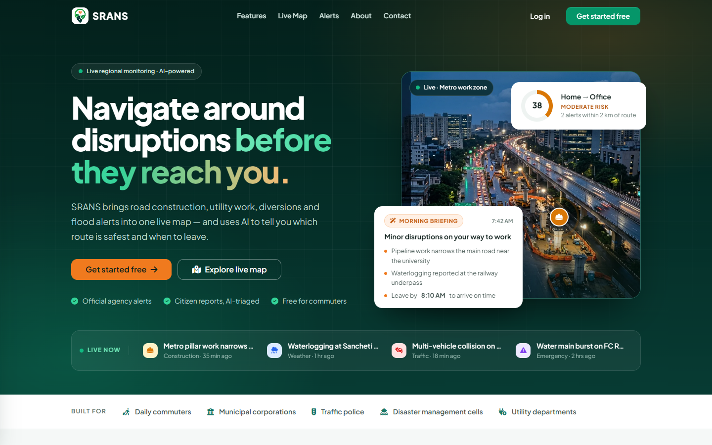

#### 2. Today, the commuter home screen
AI commute briefing, saved routes with AI risk scores, nearby alerts and report status.
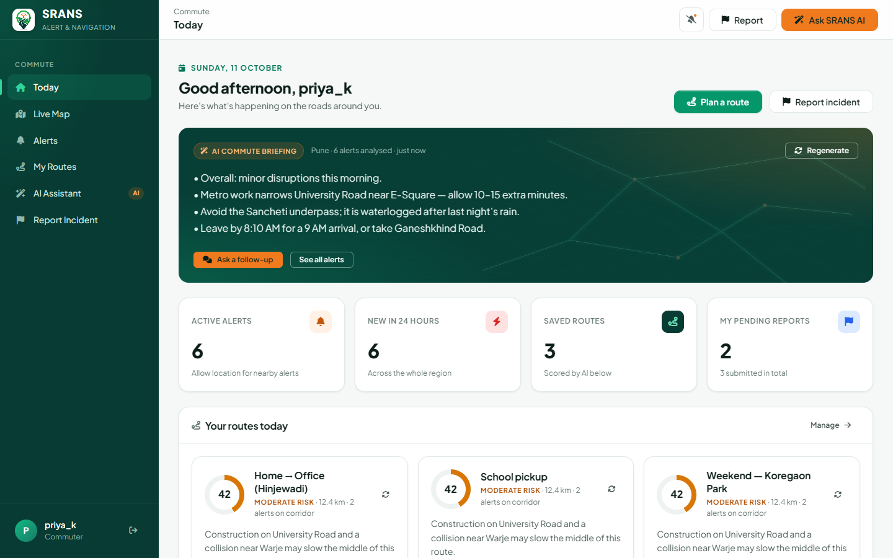

#### 3. Live disruption map
Single control panel (Route / Alerts / Layers), saved-route quick start, type filters and OpenStreetMap tiles.
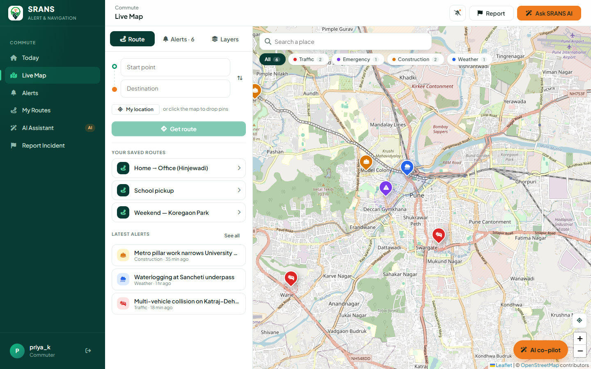

#### 4. AI travel assistant
Multi-turn chat grounded in live alerts, with a "Find alerts" smart-search mode.
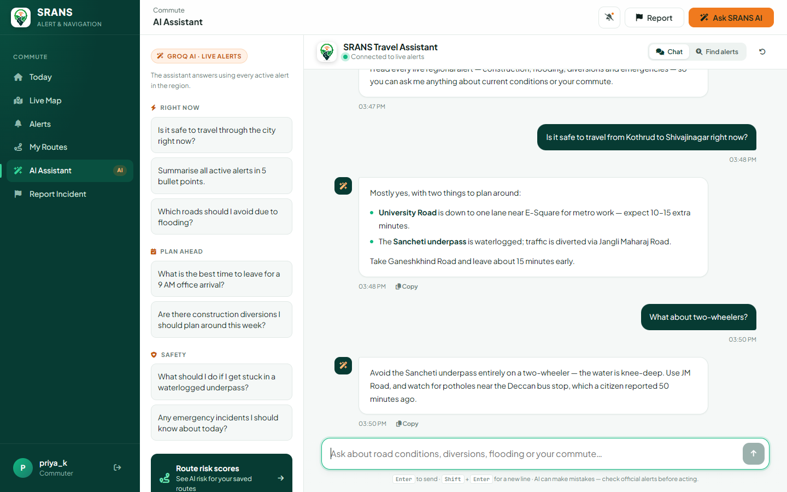

#### 5. Saved routes with AI risk scores
Each route is scored 0–100 against the alerts along its corridor, with departure advice.
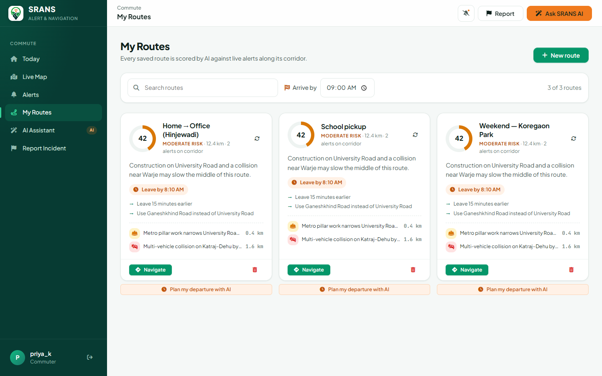

#### 6. Regional alerts with AI explanations
Filter by type, sort by distance, ask the AI about the alerts, and explain any alert's impact.
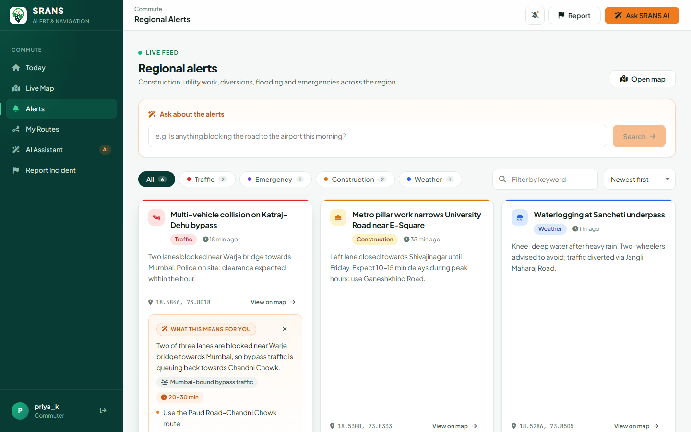

#### 7. Citizen incident reporting
Describe the incident in your own words and the AI drafts the report.
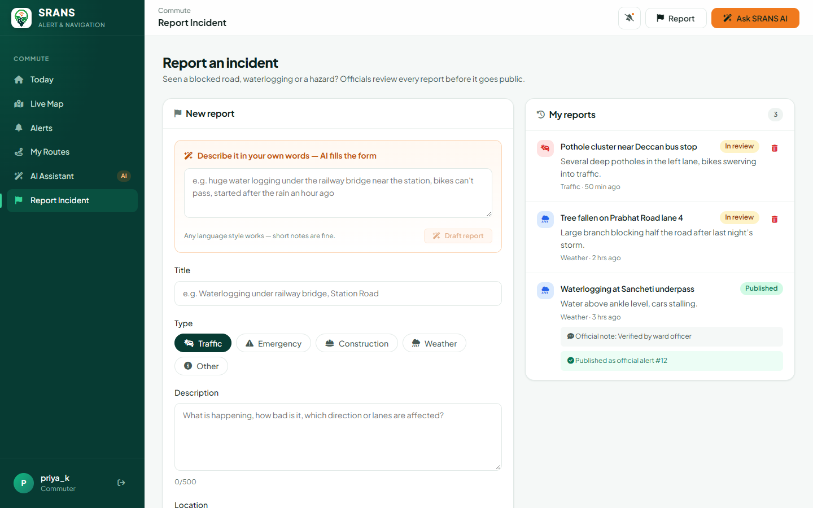

#### 8. Government Command Center
AI situation report, KPIs, published alerts and the review queue.
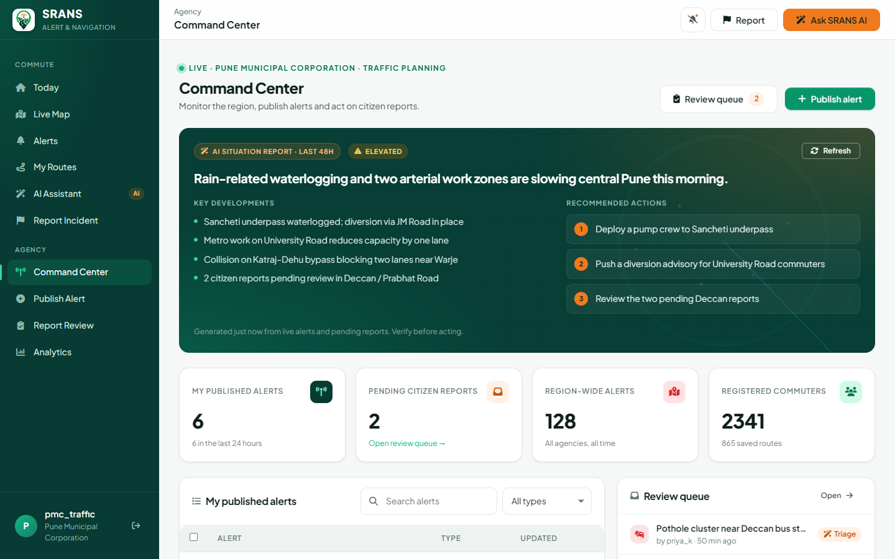

#### 9. Citizen report review with AI triage
Credibility, severity, duplicate checks and a cleaned-up version ready to publish.
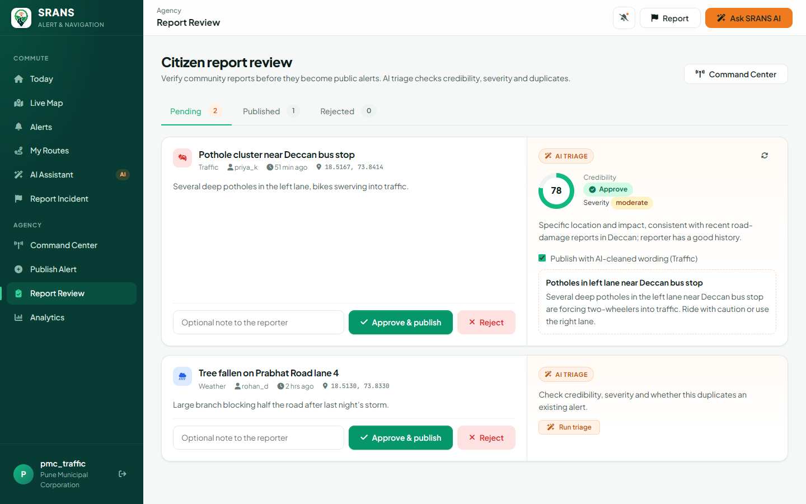

#### 10. Publish an alert with the AI drafter
Paste field notes, get a publish-ready alert, and preview it as commuters will see it.
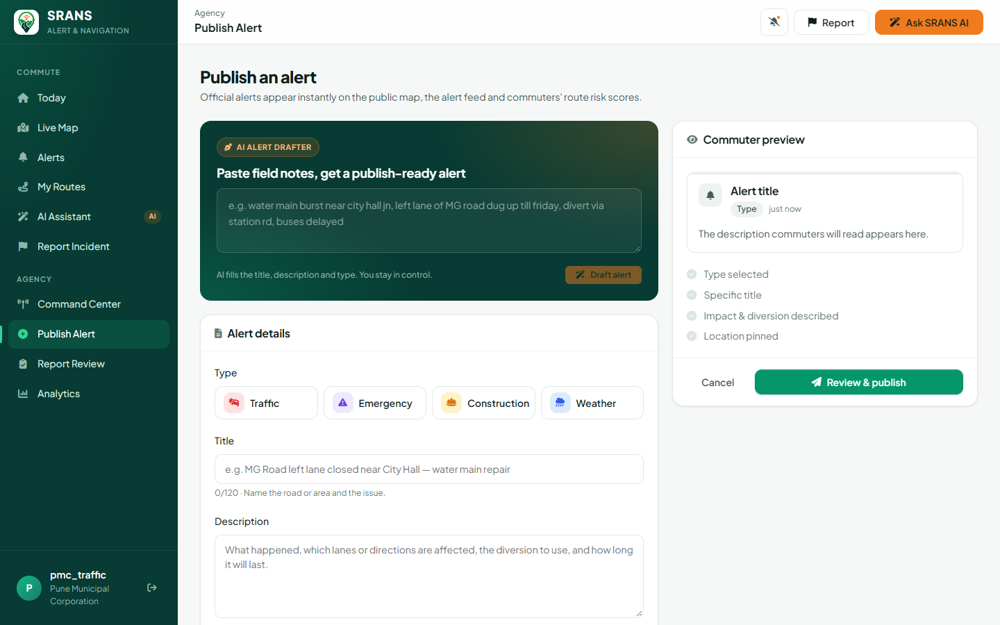

#### 11. Analytics with AI trend insights
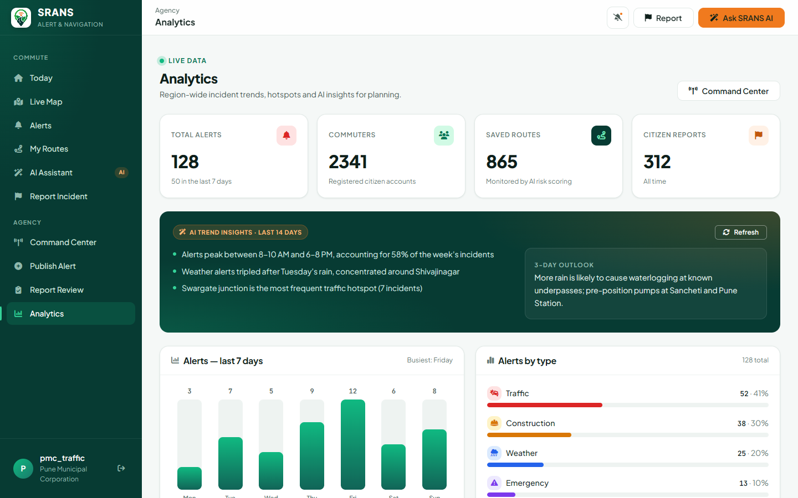

#### 12. Sign in
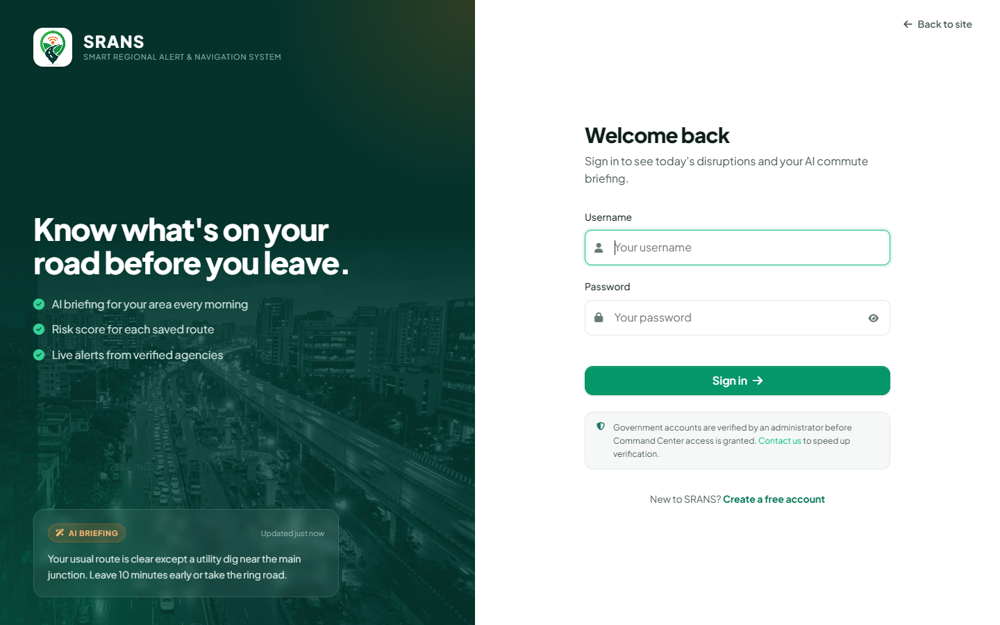

#### 13. Mobile: live map with bottom sheet
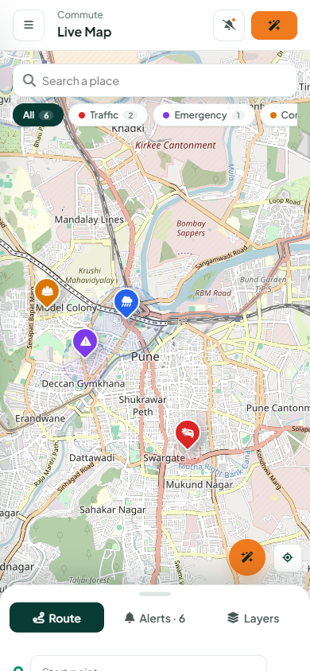

---

## 7. Architecture Diagram

Routing and geocoding run in the browser against free OpenStreetMap services. Users, alerts, reports and all AI reasoning go through the Express API.

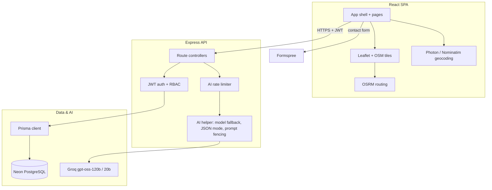

---

## 8. Database Schema (ER Diagram)

The database schema manages relational connections between users, official alerts, saved commuter routes, and crowdsourced reports.

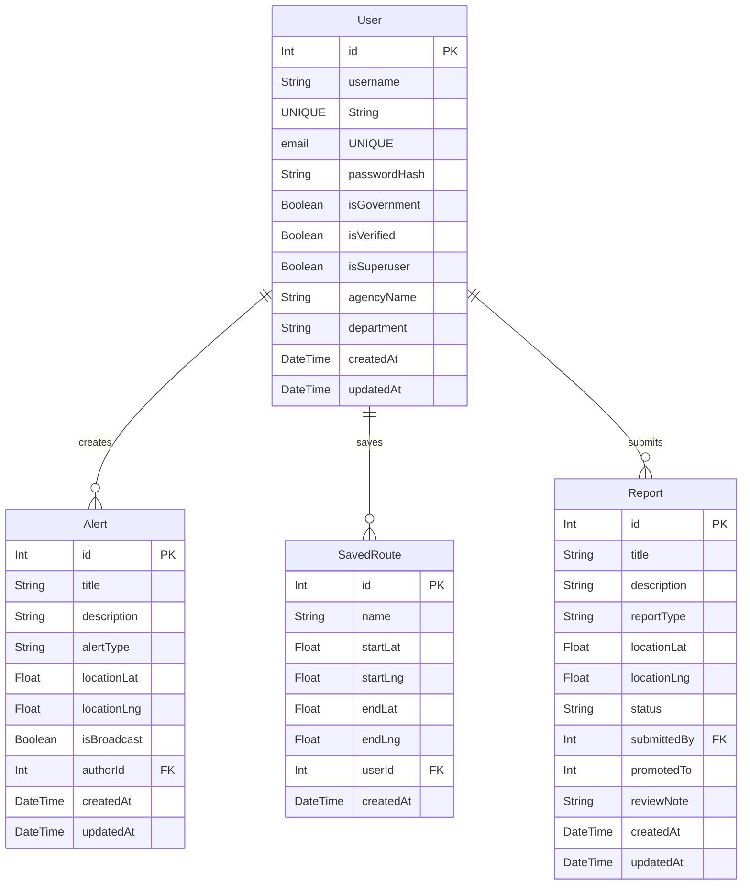

---

## 9. Authentication Flow

SRANS uses stateless JWT-based authentication. The token encapsulates user permissions, enforcing Role-Based Access Control (RBAC) across endpoints.

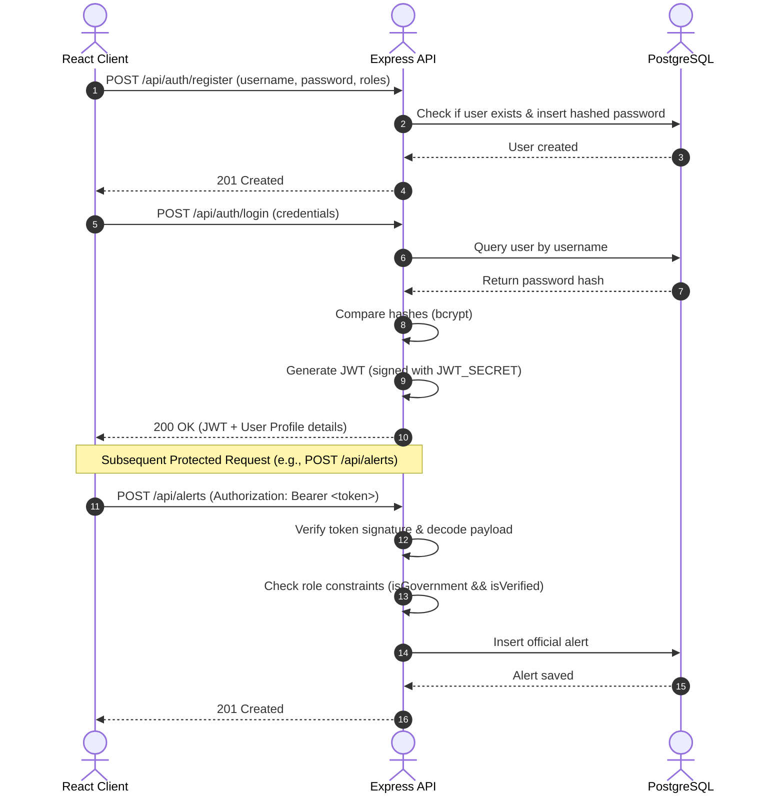

---

## 10. Challenges Faced

### 1. Leaflet State Synchronization
*   **The Issue**: React re-renders caused map markers to re-initialize and flash, or the map to lose its zoom level, whenever alerts were polled.
*   **Solution**: The map, routing control and marker collections live in `useRef`s, and markers are updated in effects that run only when the alert data or filter changes. A `ResizeObserver` calls `invalidateSize()` when the sidebar or mobile sheet resizes the map.

### 2. A Retired AI Model
*   **The Issue**: Groq shut down `llama-3.3-70b-versatile` on 16 August 2026, so every AI call started failing at once.
*   **Solution**: All LLM calls now go through one helper (`backend/src/lib/ai.ts`). It walks a model chain (`GROQ_MODEL`, then `openai/gpt-oss-120b`, then `openai/gpt-oss-20b`), skips a model Groq reports as decommissioned, and reserves completion budget for reasoning tokens so answers are never cut off.

### 3. Reliable Structured AI Output
*   **The Issue**: Free-text replies caused `JSON.parse` failures and made features like triage and risk scores unreliable.
*   **Solution**: Structured features use Groq's JSON mode plus server-side validation and clamping of every field. The route risk score is computed from geometry, and the model only writes the explanation, so the number stays stable even if the AI call fails.

### 4. Prompt Injection from User Content
*   **The Issue**: Citizen reports become alerts, and alert text is fed into prompts, so a report could try to instruct the model.
*   **Solution**: All database and user text is wrapped in delimited data blocks with an explicit rule that it is data, not instructions. Map popups escape alert text before inserting it as HTML.

### 5. Free Maps Without Sign-ups
*   **The Issue**: CARTO basemaps began returning "API KEY REQUIRED" tiles with a 200 status, so the tile fallback never triggered.
*   **Solution**: Switched to OpenStreetMap tiles with an OSM France HOT fallback, FOSSGIS OSRM with a demo-server fallback, and Photon with a Nominatim fallback, all centralised in `frontend/src/lib/mapConfig.ts` and `frontend/src/lib/geocode.ts`.

### 6. Wrong-password Logins Silently Reloading
*   **The Issue**: The API client treated every 401 as an expired session and reloaded `/login`, wiping the "invalid password" message.
*   **Solution**: Only a 401 on an authenticated, non-login request clears the session and redirects.

### 7. Layout Inside the App Shell
*   **The Issue**: Logged-in users saw the marketing landing page again, and the map page scrolled behind the viewport on mobile.
*   **Solution**: Separate layouts for the public site, the signed-in app shell and the auth screens. The map page locks document scroll and sizes itself with `100dvh`, with a bottom sheet on phones.

---

## 11. Future Improvements

1.  **WebSockets for instant broadcasts** instead of 30-second polling.
2.  **Server-side caching of AI briefings** per area to cut LLM calls during peak hours.
3.  **Spatial clustering of citizen reports** (e.g. DBSCAN) to merge duplicates automatically before triage.
4.  **AI re-routing**: feed OSRM route alternatives to the model and let it pick the one that avoids the most severe alerts.
5.  **Web Push notifications** when a saved route's risk score changes.

---

## 12. GitHub Repository

- **Repository**: [SairajJadhav08/SRANS--Smart-Regional-Alert-and-Navigation-System](https://github.com/SairajJadhav08/SRANS--Smart-Regional-Alert-and-Navigation-System)
- **Branch**: `master`, deployed to Vercel (frontend) and Render (backend).
- **Layout**: `frontend/` (React app), `backend/` (Express API), `docs/` (case study, API design, screenshots), `API_DOCUMENTATION/` (OpenAPI portal).

---

<!-- Mermaid JS support for live docs rendering -->

